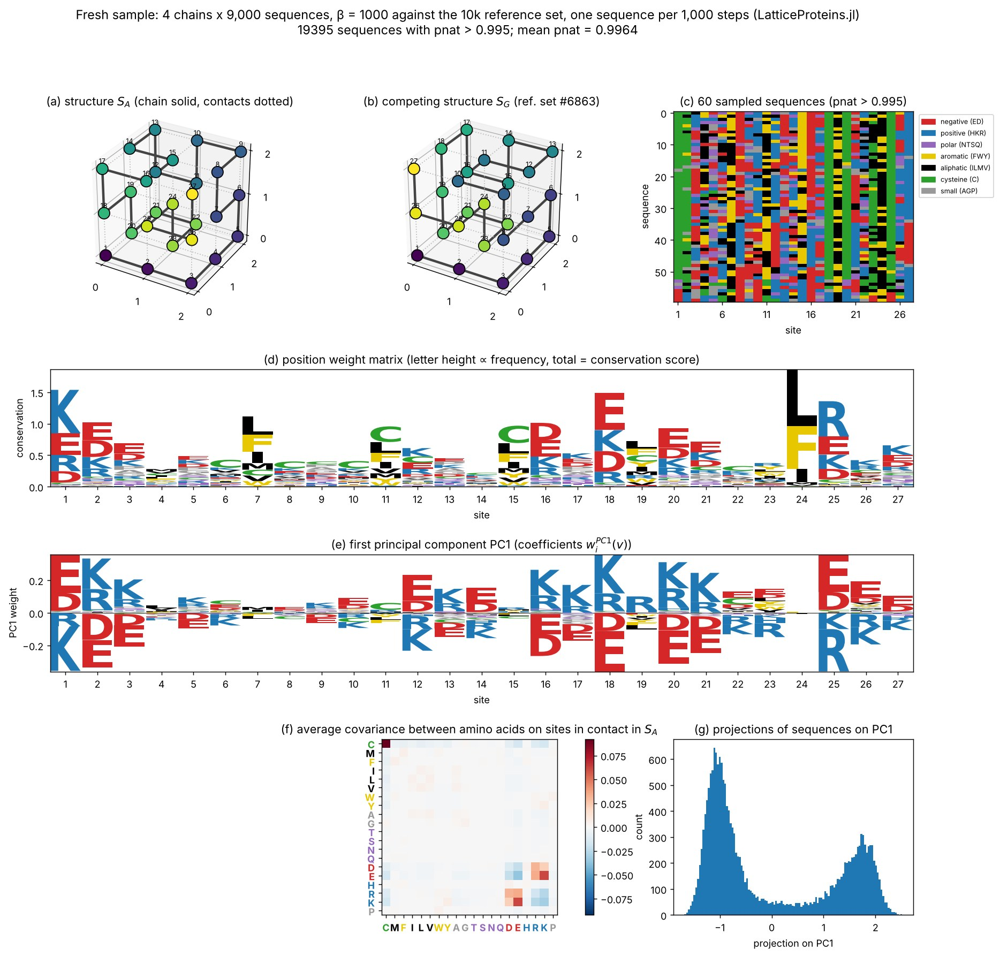
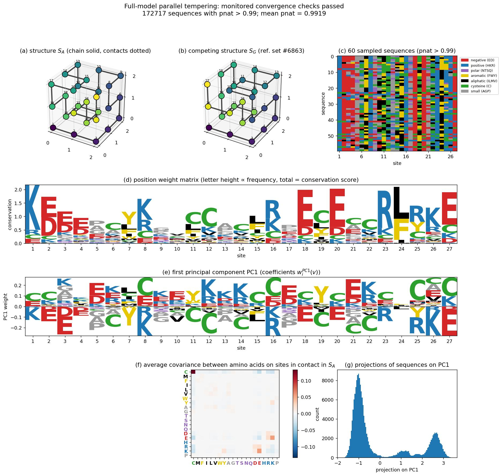
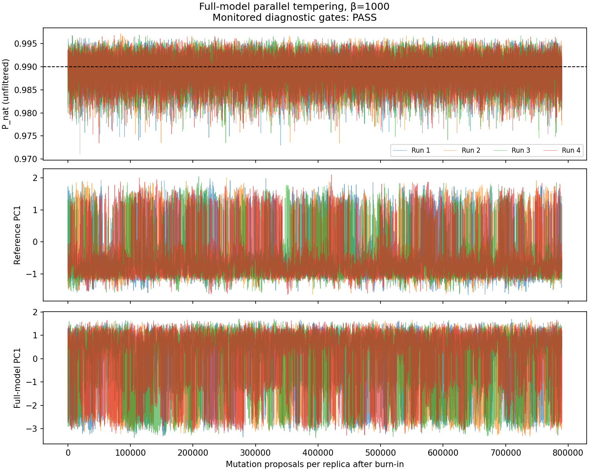

# Reproducing Fig. 4 of Tubiana et al. (2019)

```@meta
CurrentModule = LatticeProteins
```

This page reproduces Fig. 4 of

> Tubiana, J., Cocco, S., and Monasson, R. "Learning compositional representations of
> interacting systems with restricted Boltzmann machines: comparative study of lattice
> proteins." *Neural Computation* 31.8 (2019): 1671–1717.
> [doi:10.1162/neco_a_01210](https://doi.org/10.1162/neco_a_01210)
> ([arXiv:1902.06495](https://arxiv.org/abs/1902.06495))

with alignments sampled by this package, first against the subset of 10,000 structures
used in the paper ([`SHAKHNOVICH_STRUCTURES`](@ref)) and then against all 103,346 compact
structures ([`STRUCTURES`](@ref)). The full-structure figure uses the saved
parallel-tempering alignment of 316,000 sequences from four independent ladders,
with all monitored convergence criteria met. The figures below are pre-rendered;
they are not regenerated when the documentation is built (see
[Regenerating the figures](@ref) at the end of this page).

## What the original figure shows

The figure summarizes the "main features of lattice-protein sequence alignments" that the
paper then models with restricted Boltzmann machines. In the paper, the data are an alignment of
sequences that fold specifically into structure ``S_A`` ([`CONTACT_MAP_A`](@ref)), that is,
with folding probability ``P_\text{nat}(S_A \mid v) > 0.995``. Following Jacquin et al.
(2016), the sequences are generated by Metropolis Monte Carlo at inverse temperature
``\beta = 1000`` on the effective energy ``-\log P_\text{nat}``, keeping one sequence every
1,000 steps.

- **(a), (b)** Structure ``S_A`` and a *competing* structure ``S_G``, in which residues 1 and
  26 are neighbours. The paper does not say which structure ``S_G`` is; we use structure
  6863 of the reference set, which is the most frequent runner-up fold of the reference alignment's
  sequences and has that contact. Chain bonds are drawn solid, contacts dotted.
- **(c)** A subset of the sampled sequences, coloured by amino acid class.
- **(d)** Position weight matrix: at each site the total height is the conservation score
  ``\log 20 + \sum_v f_i(v) \log f_i(v)`` and each letter is proportional to its frequency
  ``f_i(v)``. Sites are either non-conserved or partly conserved; the most conserved sites
  (1, 18, 24, 25) carry charged residues forming salt bridges, or hydrophobic residues in
  the core.
- **(e)** First principal component of the one-hot encoded alignment. It is dominated by the
  *signs* of the charges on a few pairs of contacting sites (for example 1–18, 2–20, 3–26):
  the alignment splits into two subfamilies with opposite charge patterns, which the
  paper relates to the "prototype" versus "compositional" representations learnt by RBMs.
- **(f)** Average covariance between amino acids ``v, v'`` on pairs of sites in contact in
  ``S_A``, ``C(v, v') = \frac{1}{28}\sum_{ij} c^{(S_A)}_{ij}\,[f_{ij}(v, v') - f_i(v) f_j(v')]``.
  The largest entry is cysteine–cysteine, followed by positive covariances between opposite
  charges (E–K, E–R, D–K, D–R) and negative ones between like charges, reflecting the
  Miyazawa–Jernigan interactions through which amino acids interact.
- **(g)** Histogram of the projections of the sequences on the first principal component,
  showing the two subfamilies.

## Sampling protocol

The reference-subset reproduction below uses [`metropolis!`](@ref) at ``\beta = 1000``,
keeping one sequence every 1,000 steps after a burn-in of 10,000 steps, and filtering at
``P_\text{nat} > 0.995``. The full-structure experiment uses [`parallel_tempering`](@ref)
with a cold replica at the same ``\beta = 1000`` and filters at ``P_\text{nat} > 0.99``.
Before filtering, both samplers target a sequence distribution proportional to
``P_\text{nat}^{1000}`` for their respective structure sets. Replica exchange changes
how that distribution is explored; changing the competing structures or the filter
changes the ensemble being compared.

At strong selection, a single chain can remain in one sequence subfamily for a long
time. Several independent chains can reveal that problem, but do not automatically
recover equilibrium subfamily weights. High folding probabilities and accepted
temperature swaps are also insufficient evidence of equilibration. The full-model
experiment therefore records chronological traces and checks sequence observables as
well as folding probability. The reference alignment of Jacquin et al. (2016) shipped
with the package ([`Hugo_MSA`](@ref)`(:A)`) provides the published-model comparison.

## Version 1: against the subset of 10,000 structures

This is the model of the paper: `structures = SHAKHNOVICH_STRUCTURES`. The alignment was
sampled with 4 chains of 9,000 recorded sequences each (36,000 before filtering).



Agreement with the reference alignment of Jacquin et al. (sequences with
``P_\text{nat} > 0.995`` in both cases):

| statistic | fresh sample vs. reference alignment |
|:--|:--|
| site frequencies ``f_i(v)`` | Pearson ``r = 0.997`` |
| conservation profile (panel d) | Pearson ``r = 0.999`` |
| first principal component (panel e) | ``\lvert\cos\rvert = 0.998`` |
| contact covariance ``C(v, v')`` (panel f) | Pearson ``r = 0.9995`` |
| mean ``P_\text{nat}`` | ``0.9964`` in both |

The only visible difference is the relative weight of the two subfamilies in panel (g)
(60/40 here against 43/57 in the reference), which, as explained above, is set by the
basins the 4 chains fell into rather than by the model.

## Version 2: against all 103,346 compact structures

This version uses [`parallel_tempering`](@ref) against `STRUCTURES`, with four independent
ladders and a cold replica at ``\beta = 1000``. Each ladder has 26 replicas: ``\beta=0``
and 25 logarithmically spaced values from 0.1 to 1000. The physical folding temperature
remains 1. Each round performs five single-residue mutation proposals per replica,
followed by exchanges on alternating sets of adjacent temperature pairs.

Each ladder discards 4,000 burn-in rounds (20,000 proposals per replica), then records
one cold sequence every two rounds (10 proposals per replica). The initial 9,000 draws
per ladder did not pass convergence checks, so all four ladders were continued from
their final temperature states, retaining **every** production draw. The completed
run has **79,000 draws per ladder, 316,000 total**, and 810,000
mutation proposals per replica including burn-in. Each ladder has independent RNGs;
checkpoints preserve their streams throughout continuation. Saved sequences remain
correlated, so their number is not an effective sample size.

The figure scripts parallelize the four ladders externally and explicitly select
`threaded=false, rng_mode=:shared` within each ladder. This preserves the original
single-stream RNG protocol of the saved run. The package's default uses independent
per-temperature streams; both protocols target the same distribution.

**Folding probabilities above 0.99 are readily reached under the full model.** Of the
316,000 recorded sequences, 172,717 (54.7%) have ``P_\text{nat}>0.99`` and are
used below. The unfiltered mean is 0.990008; the retained mean is
0.991905; the largest observed probability is 0.997115.
The cold-replica selection strength remains ``\beta=1000``.

!!! note "Monitored convergence criteria passed"
    All 534 monitored observables satisfy rank-normalized split
    ``\widehat R < 1.01`` and bulk effective sample size at least 400; every ladder
    completes production hot–cold–hot round trips. These checks provide evidence of
    equilibration for the measured observables, not proof that every rare sequence
    family has been explored. The criteria and temperature ladder were held fixed;
    no production draws were discarded to obtain this result.



### Correctness and equilibration checks

Implementation correctness and equilibration are checked separately:

- `test/parallel_tempering.jl` compares cached energies with direct sums, checks swap
  detailed balance and replica identity, and tests the stationary distribution against
  all ``20^3=8,000`` states of an exactly enumerable three-residue model. It also compares
  uninterrupted and checkpointed trajectories, including endpoint accounting.
- Continuation uses exact integer contact sums in units of 0.01 for the bundled MJ
  interactions and tabulated Boltzmann factors. This accelerates the same transition
  kernel without rounding the interaction parameters or changing its target.
  The original floating-point kernel remains available as `energy_cache=:float`.
- Across the original and continued phases, 7,200 saved
  probabilities were independently recomputed over all 103,346 structures. The largest
  absolute discrepancy was ``2.54\times10^{-13}``.
- Diagnostics use the **unfiltered chronological traces**. They monitor folding
  probability, threshold membership, five full-model PCA coordinates, reference PC1,
  and residue indicators with frequencies between 1% and 99%. Threshold-weighted
  observables stay on the original time grid, so filtering cannot hide drift or
  shorten away correlations. Conditional-frequency Monte Carlo errors use the same
  time grid.

| diagnostic | observed | criterion |
|:--|:--|:--|
| production hot–cold–hot round trips, by ladder | 340, 312, 334, 327 | at least one in each ladder |
| largest rank-normalized split ``\widehat R`` | 1.00958 | below 1.01 |
| smallest bulk effective sample size | 443.9 | at least 400 |
| largest estimated Monte Carlo standard error of a retained residue frequency | 0.0177 | report with the estimates |

The initial 36,000-draw run had worst ``\widehat R=1.049`` and minimum effective
sample size 61.7. Diagnostics did not improve monotonically as longer runs exposed
slow cysteine-rich sequence patterns. Continuation stopped when every monitored
criterion passed. The largest conditional-frequency standard error is now about
1.8 percentage points; this uncertainty still
matters when interpreting small differences. The downloadable report includes every
continuation checkpoint's convergence summary.



### Comparison with the reference alignment

The full-model alignment above uses ``P_\text{nat}>0.99``; the reference alignment
uses ``P_\text{nat}>0.995``:

| statistic | full-model PT sample vs. reference alignment |
|:--|:--|
| site frequencies ``f_i(v)`` | Pearson ``r = 0.693`` |
| conservation profile (panel d) | Pearson ``r = 0.639`` |
| first principal component (panel e) | ``\lvert\cos\rvert = 0.139`` |
| contact covariance ``C(v,v')`` (panel f) | Pearson ``r = 0.898`` |
| mean retained ``P_\text{nat}`` | ``0.9919`` vs. ``0.9964`` |

The larger structure set changes the model: adding competitors increases the folding
partition sum and lowers ``P_\text{nat}`` for a fixed sequence. Agreement with the
10,000-structure alignment is therefore not a convergence criterion. Differences
remain after the monitored convergence checks pass; the different structure sets
and filters must both be considered when comparing the figures.

The structure panels retain the same reference ``S_A`` and illustrative ``S_G`` as the
subset reproduction; ``S_G`` is not identified as the dominant competitor under the
full model.

Download the [unfiltered alignment](assets/tubiana2019_full_pt.msa.gz) and
[complete diagnostics and run parameters](assets/tubiana2019_full_pt_diagnostics.json).
The alignment includes all four chronological runs in order, 79,000 sequences per
run. It is sufficient to redraw the figure without rerunning Monte Carlo; retain the
run boundaries when computing convergence diagnostics.

## Regenerating the figures

The scripts that produced the figures are in `docs/figures/tubiana2019/` and are not run by
the documentation build:

- `sample_msa.jl` generates the 10,000-structure reproduction with independent
  Metropolis chains, one chain per Julia thread;
- `sample_pt.jl` runs independent full-model parallel-tempering ladders and saves
  chronological traces, parameters, seeds, and exchange diagnostics;
- `continue_pt.jl` checkpoints and extends the same ladders until the fixed convergence
  criteria pass, preserving all production draws;
- `diagnose_pt.py` checks convergence with ArviZ and reports conditional-frequency errors;
- `analyze_msa.jl` computes the statistics of panels (c)–(g) and the lattice walks of
  ``S_A`` and ``S_G`` from an alignment file;
- `plot_fig4.py` draws the figure with matplotlib and logomaker from those statistics;
- `compare_stats.py` compares the statistics of two alignments.

### Redraw the full-structure figure from the saved PT samples

The repository includes the exact unfiltered PT alignment used above. From the
repository root, decompress it and apply the same ``P_\text{nat}>0.99`` filter:

```bash
gzip -dc docs/src/assets/tubiana2019_full_pt.msa.gz > full_pt.msa
julia --project=. docs/figures/tubiana2019/analyze_msa.jl full_pt.msa stats_all 0.99
python docs/figures/tubiana2019/plot_fig4.py stats_all docs/src/assets/tubiana2019_fig4_all.jpg "Full-model parallel tempering: monitored convergence checks passed"
```

This uses all 316,000 saved draws and retains 172,717 sequences for panels (c)–(g).
The accompanying `tubiana2019_full_pt_diagnostics.json` records the sampling parameters,
convergence checks, and the SHA-256 hash of the uncompressed alignment.

### Generate new alignments

To repeat the simulations, use Metropolis chains for the reference subset and
parallel tempering with convergence-based continuation for the full structure set:

```bash
julia -t 4 --project=. docs/figures/tubiana2019/sample_msa.jl shakhnovich 4 9000 msa_subset.txt
julia --project=. docs/figures/tubiana2019/analyze_msa.jl msa_subset.txt stats_subset
python docs/figures/tubiana2019/plot_fig4.py stats_subset fig4_subset.png "subset of 10,000 structures"

# Full-model run shown above: use new output directories.
# Reproduce the initial phase with the original floating-point kernel.
julia -t 4 --project=. docs/figures/tubiana2019/sample_pt.jl full_pt_initial 4 9000 1000 4000 2 5 float
# Continue with exact integer caching; checks every 10,000 added draws per ladder.
# Set TUBIANA_PYTHON if the Python executable is not named python.
julia -t 4 --project=. docs/figures/tubiana2019/continue_pt.jl full_pt_initial full_pt 2000 5
julia --project=. docs/figures/tubiana2019/analyze_msa.jl full_pt/analysis_alignment.msa stats_all 0.99
python docs/figures/tubiana2019/plot_fig4.py stats_all fig4_all.png "Full-model parallel tempering: monitored convergence checks passed"
```

Install the Python dependencies from `docs/figures/tubiana2019/requirements.txt` (Python
>=3.11). Inspect the convergence report before interpreting a regenerated figure.
`analyze_msa.jl` records the threshold in its output metadata, and `plot_fig4.py` uses
that value in its labels. Panel (c) draws 60 sequences with a fixed random seed across
the whole retained alignment.

A smaller version of this comparison runs in the test suite (`test/tubiana2019.jl`): it
samples 20 short chains against the subset of 10,000 structures and checks the statistics
of panels (d)–(g) against the reference alignment.
